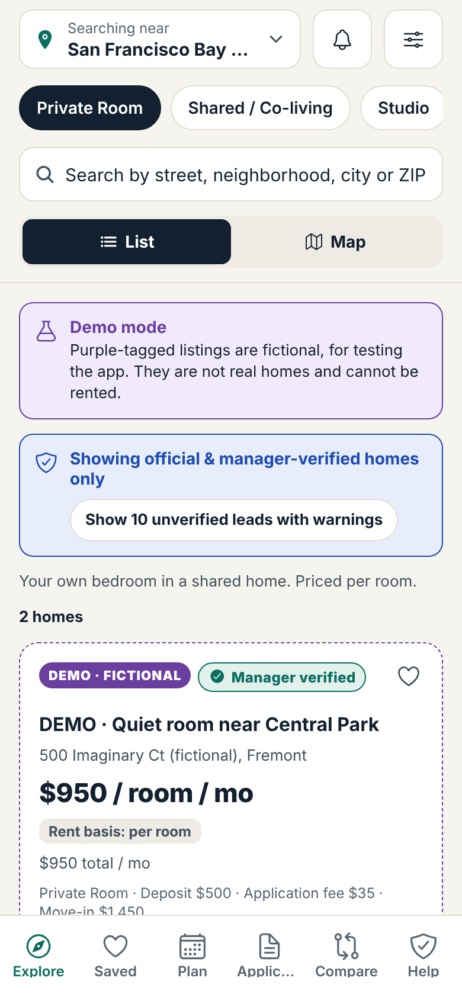

# Housing Compass

Find affordable rooms, shared housing, studios, one-bedrooms and income-restricted homes in the **San Francisco Bay Area and Los Angeles** without getting scammed.

Housing Compass shows **only official or manager-verified homes by default**. Unverified leads appear only after a warning, in their own labeled section, and every card shows its source, rent basis (per bed / room / unit), all-in monthly cost, fees, and when it was last verified.

- **Repository:** https://github.com/marcompsci/Housing-Compass
- **Status:** v0.16. Built and tested locally, installed on iPhone as a demo build. Not yet connected to a live Supabase backend. See [`docs/STATUS_REPORT.md`](docs/STATUS_REPORT.md).
- **Platforms:** iOS, Android and web from one Expo codebase
- **Languages:** English, Spanish and Simplified Chinese (translations pending native-speaker review)

> Demo mode shows purple-tagged **fictional** listings so every screen can be tried. Research leads from the Bay Area and LA PDFs are included as **unverified** leads only, never as available inventory.



## What's inside

| | |
|---|---|
| `apps/mobile` | The Housing Compass app (Expo SDK 58 + Expo Router): search, draw-an-area map, filters, listing details (travel estimates, price history, sharing), compare, saved, applications with document checklists, messages & tours (calendar export, tour-day checklist), alerts + settings, move-in savings planner, know-your-rights (CA) with deposit/fee checks, keyword search, saved areas, private notes and offline saved homes, landlord dashboard with change requests, reviewer tools, onboarding, data export |
| `packages/core` | Shared TypeScript rules: listing schema, pricing, budgets, search, trust levels, risk signals, Fair Housing screen, ingestion, alerts, affordability, regions, official programs, drawn areas, travel estimates, price history, calendar files, checklists, savings, moderation, photo pipeline |
| `supabase/` | Postgres + PostGIS migrations, row-level security, trust triggers, seeds, SQL tests, edge functions (`ingest`, `notify`, `health`, `photo-scan`) |
| `scripts/` | Seed builder, DB test runner, browser e2e + screenshots, link checker, data builders |
| `docs/` | Architecture, data sources, security, moderation SOP, roadmap, backlog and more |

## Quick start

```bash
npm install                 # Node 20+
npm test                    # 158 core tests
npm run typecheck
cd apps/mobile
npx expo start --web        # run in a browser
npx expo run:ios --device   # run on a connected iPhone (needs Xcode; MapLibre needs a dev/release build, not Expo Go)
```

Copy `.env.example` to `apps/mobile/.env` to change demo mode, the map style, or (when ready) Supabase keys.

## Tests

```bash
npm run seed:build && npm run db:test   # migrations + seeds + 21 SQL trust/RLS sections + DB↔app contract tests
npm run edge:check                      # Deno typecheck of the edge functions
npm run web:export && npm run e2e       # 73 browser checks + screenshots in docs/screenshots/
```

CI (`.github/workflows/ci.yml`) runs all of these, plus a secret scan and a dependency audit, on every push and pull request.

## Working on this project (future commits)

The project lives on the Mac at `~/Phoronomics Studio/Housing Compass`, linked to this repository (`origin`).

- **Push changes:** open **`Push Housing Compass to GitHub.command`** in `~/Phoronomics Studio`. It commits everything that changed (respecting `.gitignore`), pulls in anything new from GitHub, and pushes the branch you're on. The first push asks you to sign in to GitHub.
- **Get the latest from GitHub:** open **`Update Housing Compass from GitHub.command`**. It switches to the newest release branch (or `main` once merged) without touching your own uncommitted work.
- **Install on iPhone:** open **`Install Housing Compass on iPhone.command`** in the same folder. It builds a Release (demo-mode) build and installs it on the connected iPhone.
- From a terminal: `cd ~/Phoronomics\ Studio/Housing\ Compass && git add -A && git commit -m "…" && git push`

Never commit secrets: only `EXPO_PUBLIC_*` values belong in the app. The Supabase service-role key, `CRON_SECRET` and `EXPO_ACCESS_TOKEN` go in Supabase / EAS secrets.

## Trust rules (enforced in code, database triggers, and RLS)

| Level | Meaning |
|---|---|
| Official portal | Published by an authorized official portal. Not a guarantee of a vacancy. |
| Manager verified | A reviewer confirmed authority to rent, address/unit, availability, rent, contact channel and fees, with evidence for all six |
| Unverified lead | Seen on another website. Hidden by default. Shown only behind a warning. |
| Under review / Expired | Hidden. "Under review" is never a fraud verdict. |

No listing can become verified just because it appears on a major listing site, and no app can guarantee scam-free listings.

## Docs

- [`docs/STATUS_REPORT.md`](docs/STATUS_REPORT.md): what works now, what's demo, what needs credentials
- [`docs/ARCHITECTURE.md`](docs/ARCHITECTURE.md), [`docs/ADR.md`](docs/ADR.md): structure and decisions
- [`docs/DATA_SOURCES.md`](docs/DATA_SOURCES.md), [`docs/CONNECTOR_CONTRACT.md`](docs/CONNECTOR_CONTRACT.md): sources, legal basis, how to add one
- [`docs/MODERATION_SOP.md`](docs/MODERATION_SOP.md): reviewer handbook
- [`docs/SECURITY.md`](docs/SECURITY.md), [`docs/PRIVACY_SECURITY_CHECKLIST.md`](docs/PRIVACY_SECURITY_CHECKLIST.md)
- [`docs/DEPLOY.md`](docs/DEPLOY.md), [`docs/RELEASE_CHECKLIST.md`](docs/RELEASE_CHECKLIST.md)
- [`docs/ROADMAP.md`](docs/ROADMAP.md), [`docs/BACKLOG.md`](docs/BACKLOG.md)
- [`docs/OBSERVABILITY.md`](docs/OBSERVABILITY.md), [`docs/I18N.md`](docs/I18N.md)

Built by Omari Bell · Phoronomics Studios
